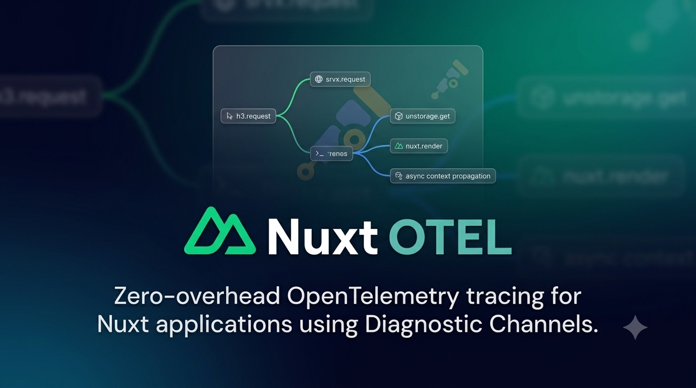
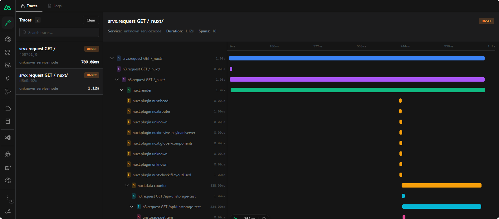
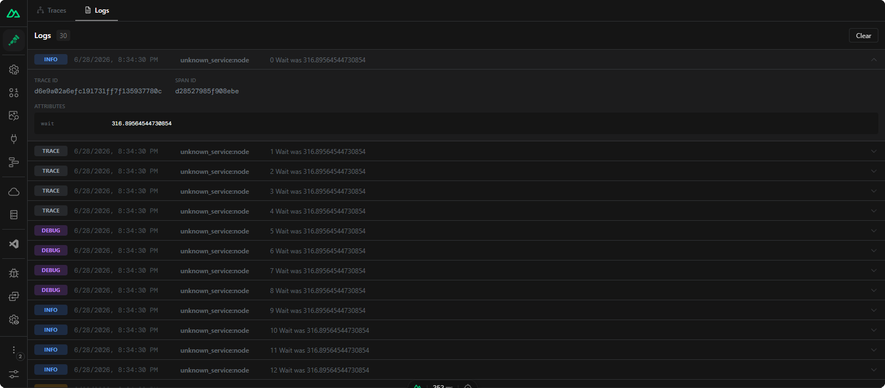

[](https://github.com/lutejka/nuxt-otel)

[![License][license-src]][license-href]
[![Nuxt][nuxt-src]][nuxt-href]

# Nuxt OTel

OpenTelemetry tracing for Nuxt applications using Diagnostic Channels.

- [✨ &nbsp;Release Notes](/CHANGELOG.md)

## Features

- 🪡 Built on top of [Node.js Diagnostic Channels](https://nodejs.org/api/diagnostics_channel.html) for zero-overhead instrumentation
- 🎯 Automatic tracing for Nuxt renders, H3 requests, server routes, and Unstorage operations
- 🔗 Proper context propagation across async boundaries using OpenTelemetry AsyncLocalStorage
- 🚀 Lightweight — minimal overhead, no application code changes required

## Background

Instrumenting Nuxt applications with OpenTelemetry traditionally requires manual span creation and management. Diagnostic Channels provide a native Node.js mechanism for hooking into internal operations with minimal overhead.

Nuxt OTel leverages these channels to automatically create OpenTelemetry spans for key Nuxt internals — renders, API requests, server route handling, and storage operations — giving you deep observability with zero application code changes.

## 🚀 Quick Setup

Install the module:

```bash
pnpm i @lutejka/nuxt-otel
```

Then add it to the `modules` array in your Nuxt config:

```ts
export default defineNuxtConfig({
  modules: ['@lutejka/nuxt-otel'],
})
```

### Configuration

#### Module options

```ts
export default defineNuxtConfig({
  nuxtOtel: {
    // Enable built-in OpenTelemetry SDK (Node.js only)
    instrument: true,
    // Enable the OpenTelemetry panel in Vite DevTools
    devtools: true,
  },
})
```

#### Tracing channels

The tracing channels themselves are configured via the top-level `tracingChannel` Nuxt option:

```ts
export default defineNuxtConfig({
  tracingChannel: {
    nuxt: true, // Nuxt render lifecycle
    h3: true, // H3 request handling
    srvx: true, // Server route requests
    unstorage: true, // Storage operations
  },
})
```

Tracing channels are opt-in. Set `tracingChannel: true` to enable all channels, or `false` to disable all. An object enables every channel that is not explicitly set to `false`.

## 🔧 Instrumentation

The built-in SDK uses `@opentelemetry/sdk-node` and is designed for Node.js presets.

> The module currently loads the Node.js preset whenever `instrument` is enabled, regardless of your Nitro preset. On other presets, set `instrument: false` and provide your own SDK.

### Node.js

For `node-server` (or `node_server`/`nodeServer`), `bun`, or the default preset, the module adds a built-in `NodeSDK` instance that exports traces via OTLP. The instrumentation can be configured via [OTel SDK environment variables](https://opentelemetry.io/docs/specs/otel/configuration/sdk-environment-variables/):

| Variable                | Description                                                |
| ----------------------- | ---------------------------------------------------------- |
| `OTEL_TRACES_EXPORTER`  | Trace exporter (`otlp`, `console`, `none`)                 |
| `OTEL_METRICS_EXPORTER` | Metrics exporter (`otlp`, `console`, `prometheus`, `none`) |
| `OTEL_LOGS_EXPORTER`    | Logs exporter (`otlp`, `console`, `none`)                  |

### Custom instrumentation

For presets not listed above, or when you need full control, disable the built-in setup and provide your own:

```ts
// nuxt.config.ts
export default defineNuxtConfig({
  nuxtOtel: {
    instrument: false,
  },
})
```

Install the OpenTelemetry packages used by the example:

```bash
pnpm add @opentelemetry/sdk-node @opentelemetry/exporter-trace-otlp-http @opentelemetry/resources @opentelemetry/semantic-conventions
```

```ts
// server/plugins/otel.ts
import { OTLPTraceExporter } from '@opentelemetry/exporter-trace-otlp-http'
import { resourceFromAttributes } from '@opentelemetry/resources'
import { NodeSDK } from '@opentelemetry/sdk-node'
import { ATTR_SERVICE_NAME } from '@opentelemetry/semantic-conventions'
import { defineNitroPlugin } from 'nitropack/runtime'

export default defineNitroPlugin((nitroApp) => {
  const sdk = new NodeSDK({
    resource: resourceFromAttributes({
      [ATTR_SERVICE_NAME]: 'my-nuxt-app',
    }),
    traceExporter: new OTLPTraceExporter({
      url: 'http://my-collector:4318/v1/traces',
    }),
  })

  sdk.start()

  // Flush buffered telemetry when the server shuts down.
  nitroApp.hooks.hook('close', () => sdk.shutdown())
})
```

You can use any exporter (Console, Jaeger, Zipkin) or add auto-instrumentations like `@opentelemetry/instrumentation-http`.

## 🧩 Server Composables

The module provides three composables for manual instrumentation in your server routes.

### `useOtelTracer(namespace)`

Creates a tracer that wraps async operations in OpenTelemetry spans.

```ts
import { defineEventHandler } from 'h3'

export default defineEventHandler(async () => {
  const { trace } = useOtelTracer('checkout')

  const result = await trace('process-payment', async () => {
    // this runs inside an OpenTelemetry span named "checkout.process-payment"
    const payment = await processPayment()
    return payment
  })

  return result
})
```

### `useOtelLogger()`

Returns an OpenTelemetry logger instance for emitting structured logs.

```ts
import { defineEventHandler } from 'h3'

export default defineEventHandler(async () => {
  const logger = useOtelLogger()

  logger.emit({
    severityNumber: 9,
    body: 'Payment processed',
    attributes: { amount: 42, currency: 'USD' },
  })
})
```

### `useOtelMeter(namespace?)`

Returns an OpenTelemetry meter for recording custom metrics.

```ts
const quantity = useOtelMeter('orders').createHistogram('orders.quantity', {
  description: 'Quantity of items in completed orders',
  unit: '{item}',
})

export default defineEventHandler(async (event) => {
  const body = await readBody(event)
  const order = await placeOrder(body)

  // Histograms are rendered in DevTools as sum / count,
  // so this metric shows the average order quantity.
  quantity.record(body.quantity)

  return order
})
```

`useOtelMeter` works with counters, gauges, and histograms from the OpenTelemetry metrics API.

Spans, metrics, and logs created with these composables automatically appear in the DevTools UI when devtools are enabled.

## 📡 Traced Events

| Channel           | Events                                      | Required Nuxt Version |
| ----------------- | ------------------------------------------- | --------------------- |
| `nuxt.render`     | SSR renders                                 | >= 4.5.0              |
| `nuxt.island`     | Island component renders                    | >= 4.5.0              |
| `nuxt.data`       | Data fetching operations                    | >= 4.5.0              |
| `nuxt.plugin`     | Plugin initialization                       | >= 4.5.0              |
| `h3.request`      | HTTP requests via h3                        | >= 5.0.0              |
| `srvx.request`    | Server route requests                       | >= 5.0.0              |
| `srvx.middleware` | Server route middleware                     | >= 5.0.0              |
| `unstorage.*`     | Storage operations (get, set, remove, etc.) | >= 5.0.0              |

## 🏗️ How It Works

Each traced operation follows the Diagnostic Channels lifecycle:

1. **Start**: When an operation begins, a span is created with contextual attributes (URL, method, component name, etc.)
2. **Async Context**: The span is bound to the current async context via `AsyncLocalStorage`, ensuring child spans maintain parent relationships
3. **End**: On completion, the span is finalized with response metadata (status code, etc.)
4. **Error**: If the operation fails, the span records the exception and marks the status as error

## 🖥️ DevTools UI

When devtools are enabled (`devtools: true` in `nuxtOtel` config), the module adds an **OpenTelemetry** panel to [Vite DevTools](https://devtools.vite.dev) for browsing traces, logs, and metrics in real time. It is powered by [`vite-opentelemetry-inspector`](https://github.com/lutejka/vite-opentelemetry-inspector).

**Traces** shows a resizable split panel with a trace list on the left and a waterfall timeline with span details on the right.



**Logs** provides a scrollable list of log entries with expandable metadata.



**Metrics** shows one tile per metric with its latest value, a sparkline, and a histogram chart. Histograms are displayed as their average (`sum / count`), so a histogram named `orders.quantity` reads as the average order quantity.

When using a custom instrumentation setup (i.e. `instrument: false`), you can still forward spans, logs, and metrics to the DevTools panel. Point your exporter at the ingest endpoint:

```
OTEL_EXPORTER_OTLP_ENDPOINT={devServerUrl}/__opentelemetry-ingest
```

The OTLP HTTP exporter appends the signal path, so traces go to `{devServerUrl}/__opentelemetry-ingest/v1/traces`, logs to `/v1/logs`, and metrics to `/v1/metrics`. You can also use those full URLs directly.

## 🔌 MCP Server

> **Note:** The MCP integration is development-only. The OTel tools query in-memory trace, log, and metric stores that are populated during development. In production builds, the OTel-specific tools are not available.

The OpenTelemetry panel exposes agent tools (`get-traces`, `get-trace`, `get-spans`, `get-logs`, `get-metrics`, `clear-traces`, `clear-logs`, `clear-metrics`) over the devframe MCP adapter provided by [`vite-opentelemetry-inspector`](https://github.com/lutejka/vite-opentelemetry-inspector#mcp).

### Prerequisites

The MCP endpoint is only mounted when the optional `@devframes/agentic` peer is installed. Without it, devframe logs `DF0078`, serves no MCP endpoint, and the terminal shows `MCP server → disabled`.

```bash
pnpm add -D @devframes/agentic
```

### Endpoint

Start the dev server with DevTools enabled (`nuxtOtel.devtools: true`) and look for the `Nuxt OTel devtools` box in the terminal:

```
Nuxt OTel devtools:
  OTLP HTTP ingest  → http://localhost:3000/__opentelemetry-ingest
  MCP server        → http://localhost:3000/__opentelemetry/__mcp
```

### Connect an agent

Point your MCP client at the `__mcp` URL as a remote server. Devframe rejects requests without a matching `Origin` header, so always set `Origin` to your dev server origin:

```json
{
  "mcp": {
    "nuxt-otel": {
      "type": "remote",
      "url": "http://localhost:3000/__opentelemetry/__mcp",
      "headers": {
        "Origin": "http://localhost:3000"
      },
      "enabled": true
    }
  }
}
```

If your dev server runs on a different port or host, update both `url` and the `Origin` header to match it.

### Available tools

| Tool           | Description                                                 |
| -------------- | ----------------------------------------------------------- |
| `get-traces`   | Retrieve all collected OpenTelemetry traces                 |
| `get-trace`    | Retrieve a single trace and its spans by `trace_id`         |
| `get-spans`    | Retrieve collected spans, optionally filtered by `trace_id` |
| `get-logs`     | Retrieve all collected OpenTelemetry logs                   |
| `clear-traces` | Clear all collected traces and spans                        |
| `clear-logs`   | Clear all collected logs                                    |

- **Endpoint shows `disabled`** — install `@devframes/agentic` as a dev dependency and restart the dev server.
- **Request rejected or forbidden** — set the `Origin` header to your exact dev server origin (scheme + host + port).
- **Empty traces or logs** — load a page in the browser first so the in-memory stores are populated, then query again.

## ⛰️ Next Steps

- 📖 Explore the [OpenTelemetry Documentation](https://opentelemetry.io/docs/)

## ⚖️ License

Licensed under the [MIT license](/LICENSE).

## Contribution

<details>
  <summary>Local development</summary>

```bash
# Install dependencies
pnpm install

# Generate type stubs
pnpm dev:prepare

# Develop with the playground
pnpm dev

# Build the playground
pnpm dev:build

# Run ESLint
pnpm lint

# Run Vitest
pnpm test
pnpm test:watch

# Release new version
pnpm release
```

</details>

[license-src]: https://img.shields.io/npm/l/nuxt-otel.svg?style=flat&colorA=020420&colorB=00DC82
[license-href]: https://npmjs.com/package/nuxt-otel
[nuxt-src]: https://img.shields.io/badge/Nuxt-020420?logo=nuxt
[nuxt-href]: https://nuxt.com
